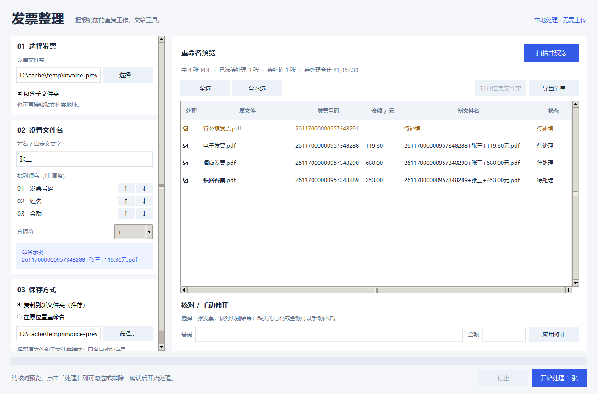

# 发票整理 · Batch Invoice Renamer

> **Chatgpt代充：[aishopvip.com](https://aishopvip.com)**

一个有本地窗口界面的 PDF 发票批量重命名工具。选择发票文件夹，核对号码和金额，自定义姓名与命名顺序，再一键整理。

发票在本机读取和处理，不上传文件，也不需要 API Key。界面使用 Python 自带的 Tkinter，无需安装 Node.js 或启动网页服务。



## 能做什么

- **选择或输入路径**：点击按钮选择文件夹，也可以直接粘贴地址，支持带引号的路径。
- **自由修改姓名**：刘永军、张三、李四或其他自定义文字，不用改代码。
- **调整命名顺序**：用 ↑↓ 按钮排列发票号码、姓名、金额，支持全部六种组合。
- **选择分隔符**：`+`、`_`、`-` 或空格，金额统一保留两位小数并附上“元”。
- **两种保存方式**：默认复制到新文件夹，也能直接在原位置重命名；输出位置可选择或手动输入。
- **先预览再执行**：逐张查看原文件、识别结果、新文件名和状态；点击“处理”列勾选或排除。
- **手动修正**：识别缺失或不准确时，选择该行，在下方修改发票号码和金额，再点“应用修正”。
- **大批量处理**：后台识别、进度显示、停止按钮；可选是否扫描子文件夹。
- **结果清单**：导出带原始路径、目标路径和失败原因的 CSV，便于复核与追踪。
- **记住设置**：自动保存姓名、排列顺序、分隔符及文件夹位置。

例如，可以生成：

```text
26117000000957348288+张三+119.30元.pdf
张三_119.30元_26117000000957348288.pdf
119.30元-26117000000957348288-李四.pdf
```

## Windows 快速开始

需要 **Python 3.10 或以上版本**，安装时勾选 **Add Python to PATH**。

1. 第一次使用，双击 **安装依赖.bat**，等提示安装完成。
2. 以后直接双击 **一键重命名.bat**，打开工具窗口。
3. 选择或输入发票文件夹，填写姓名，用 ↑↓ 调整命名顺序。
4. 选择“复制到新文件夹”或“在原位置重命名”，设置保存位置。
5. 点击 **扫描并预览**，检查金额、补填缺失信息，取消不想处理的发票。
6. 点击 **开始处理**，完成后打开结果文件夹，或导出清单。

安装脚本会在项目目录中创建 `.venv`，依赖仅安装到这个项目的虚拟环境。启动脚本会优先使用它。

手动安装与运行也可以：

```powershell
python -m venv .venv
.\.venv\Scripts\python.exe -m pip install -r requirements.txt
.\.venv\Scripts\python.exe rename_invoice.py
```

macOS / Linux 可在安装 Tkinter 的 Python 环境中运行 `python rename_invoice.py`；当前主要在 Windows 上验证。

## 保存方式与文件保护

### 复制到新文件夹（默认）

原文件保持原样，在结果目录生成命名后的副本，同时保留子文件夹结构。不填保存位置时，扫描会自动建议原文件夹旁边的 `原文件夹名_已重命名`。

可以手动输入一个尚不存在的结果目录，开始处理时自动创建。结果目录不能与原目录相同，也不能是原目录的上级目录。若结果目录位于原目录内部，扫描会排除它，避免重复处理历史输出。

### 在原位置重命名

直接修改源 PDF 的文件名，**不会修改 PDF 内容**。执行前会在界面确认；下次启动仍默认使用复制模式。此版本没有一键撤销，建议先导出预览清单；需要保留原始命名时请选择复制模式。

两种模式遇到同名都自动追加 `_2`、`_3` 等序号，**不会用一张发票覆盖另一张**。如果预览后突然出现了同名文件，该项会报错并保留原文件；预览后源文件变化也会拒绝处理，提示重新扫描。

点击停止会在当前文件结束后停止，已完成的结果保留。再次处理需要重新扫描，避免对旧预览重复执行。

## 识别范围与复核

主要支持有可提取文字的电子发票、铁路客票等 PDF。从**第一页**识别 8 至 20 位发票号码和金额，优先提取“小写 / 价税合计”，支持千位分隔符和负数金额。

**自动识别仍需人工核对。** 特殊版式可能把其他金额误识别为总额。如果没有明确的总额标识且出现多个货币值，程序会留空让你补填。

- 纯图片扫描件目前**不支持 OCR**，可在预览表中手动填写号码和金额。
- 加密、损坏或无法读取的 PDF 会显示具体原因。
- 信息不全的发票在执行时跳过，原文件保留；确认弹窗会显示跳过数量。
- 只处理 PDF，其他格式不处理；文件和目录的符号链接不会扫描。
- 姓名不能为空，也不能含 Windows 文件名禁止的字符，例如 `/`、`\`、`:`、`*`。
- “待处理合计”仅统计已勾选且信息完整的待处理行，不负责识别业务上的重复报销。

CSV 使用 UTF-8 BOM，便于 Excel 打开。20 位发票号码前加英文单引号，避免 Excel 转成科学计数或丢失精度；使用普通 CSV 读取器时也会看到这个保护前缀。

## 设置保存在哪里

Windows：`%APPDATA%\BatchInvoiceRenamer\settings.json`。

其他系统：`~/.config/BatchInvoiceRenamer/settings.json`。删除此文件即可恢复默认设置，设置文件不会写进项目或上传到 GitHub。

## 开发与验证

```powershell
.\.venv\Scripts\python.exe -m unittest discover -v
```

测试使用临时目录和合成的中文 PDF，覆盖真实 PDF 提取、六种命名顺序、两种保存方式、重名保护、源文件变更、复制失败清理、取消任务、递归排除、CSV 导出和真实 Tk 控件操作。界面测试需要可用的桌面显示环境。

当前 24 项自动化测试通过，并额外用 3 张本地实际发票核对了识别金额和复制前后的文件校验值。

```text
rename_invoice.py   启动入口（保留原命令）
invoice_app.py      本地窗口、预览、手动修正与后台任务
invoice_core.py     PDF 识别、命名规则与安全文件处理
tests/             自动化测试
安装依赖.bat        Windows 首次安装
一键重命名.bat      Windows 双击启动
worklog/           中文工作记录
```

## 作者

由 [jedliuai](https://github.com/jedliuai) 维护。

关键词：发票批量重命名、PDF 发票整理、电子发票、报销整理、batch invoice renamer、Chinese invoice。
